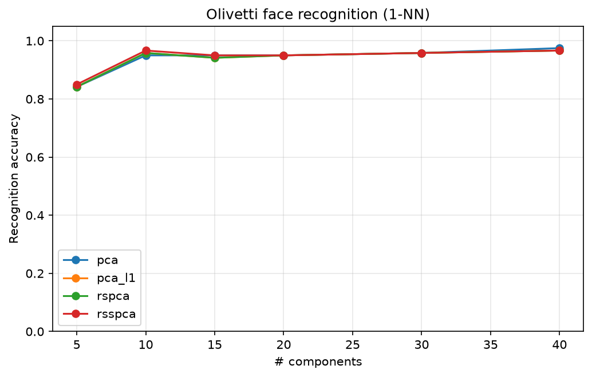
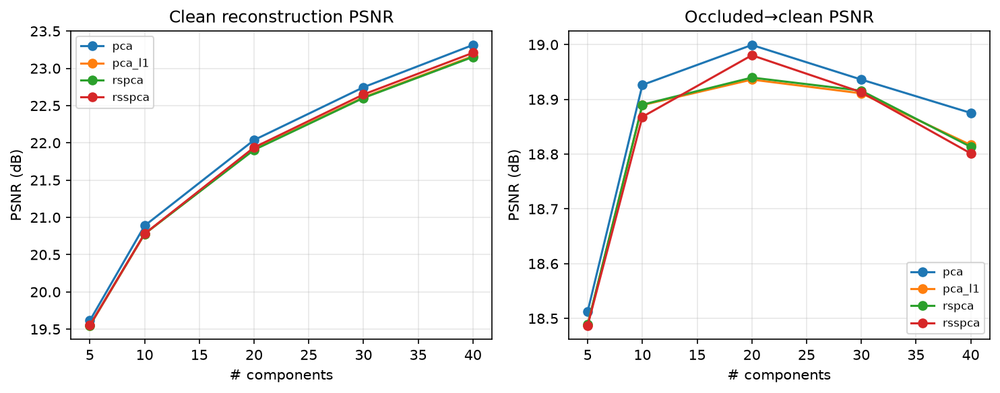

# AI Assignment #3

**Robust Sparse Smooth PCA (RSSPCA) for Face Reconstruction and Recognition**

**CISC3024 Pattern Recognition**  
Name: CHE CHI HIN, Angus  
Student ID: UC325182  
November 2026

> Deliverable: `AIAssignment3_Report.pdf`. Source: https://github.com/AngusJai/CISC3024-AI-Assignment3

## Abstract

**Thesis:** A 2025 PCA variant—**RSSPCA** (Robust Sparse Smooth PCA)—adds graph-Laplacian smoothness on top of L1 robustness and sparsity, and is a natural fit for classical face pattern recognition. Under Cursor AI direction (no hand-written student code), we reimplemented RSSPCA in Python, compared it with PCA / PCA-L1 / RSPCA on the AT&T ORL face database, and verified competitive reconstruction plus strong mid-dimensional recognition. This report covers the required six sections.

---

## 1 How AI Finds the Algorithm

I used **Cursor only**. The assignment requires a **recent PCA/LDA** method with a computer-vision / pattern-recognition application. I asked the agent to (i) search recent literature, (ii) propose 2–3 options with trade-offs, and (iii) avoid copying Ass1’s deep-CNN story.

The agent shortlisted:

| Candidate | Year / venue | Fit | Risk |
|-----------|--------------|-----|------|
| FF-PCA-LDA (plant disease) | 2022 Applied Sciences | PCA+LDA pipeline | Heavy deep-feature fusion, less “pure” PCA |
| 2DPCA + LDA / 2DLDA | 2024 IAEAC | Classic SSS fix | Incremental vs. classical 2DPCA |
| Robust Sparse LDA | 2024 Pattern Recognition | Strong LDA paper | Harder ADMM-style solver |
| **RSSPCA** | **2025 PLOS One** | **Robust + sparse + smooth PCA; face recon/recog; public code** | Need careful multi-component deflation |

I approved **option A: RSSPCA** (Wang et al., *PLOS One*, May 2025, DOI: [10.1371/journal.pone.0323281](https://doi.org/10.1371/journal.pone.0323281); official MATLAB reference: [github.com/yuzhounh/RSSPCA](https://github.com/yuzhounh/RSSPCA)). Delivery matched Ass1: new repo, English PDF, process log, public GitHub link. See `process_log.md`.

---

## 2 Algorithm Description

### 2.1 From PCA to RSPCA

Let training faces be mean-centered columns \(X \in \mathbb{R}^{d \times n}\). Classical **PCA** maximises \(\|X^\top w\|_2^2\) under \(\|w\|_2=1\). **PCA-L1** replaces the objective by \(\|X^\top w\|_1\) for robustness to outliers. **RSPCA** further adds an L1 constraint on \(w\) so loadings are sparse.

### 2.2 RSSPCA objective

RSSPCA (Wang et al., 2025) keeps the L1 objective and adds a **smoothness** constraint via a pixel-grid Laplacian \(L\):

\[
\max_w \; \|X^\top w\|_1
\quad\text{s.t.}\quad
\|w\|_2^2=1,\;
\|w\|_1 \le c_1,\;
w^\top L w \le c_2.
\]

Here \(L = D - A\) uses 4-neighbour adjacency on the \(h \times w\) image lattice. Then \(w^\top L w = \tfrac12\sum_{i,j} A_{ij}(w_i-w_j)^2\) penalises dissimilar weights on adjacent pixels, encouraging spatially coherent “eigenfaces”.

### 2.3 MM iterative solver

Because of the L1 terms, the paper uses a **Minorization–Maximization (MM)** surrogate. With sparsity / smoothness weights \(\eta_1,\eta_2 \ge 0\), each iteration (Algorithm 1) does:

1. \(U^{(k)}=\mathrm{diag}(|w^{(k)}|)\), \(v^{(k)}=X\,\mathrm{sign}(X^\top w^{(k)})\)
2. \(u^{(k)}=(U^{(k)}+\eta_1 I+\eta_2 U^{(k)}L)^{-1} U^{(k)} v^{(k)}\)
3. \(w^{(k+1)}=u^{(k)}/\|u^{(k)}\|_2\)

until the L1 objective stabilises. Multiple components use deflation \(X \leftarrow (I-WW^\top)X\). Our Python port adds Gram–Schmidt re-orthogonalisation so \(W\) stays numerically orthonormal.

**Intuition:** \(\eta_1\) trades sparsity vs. L2; \(\eta_2\) trades smoothness vs. L2. Setting \(\eta_2=0\) recovers an RSPCA-like sparse robust PCA; \(\eta_1=\eta_2=0\) recovers PCA-L1 behaviour.

---

## 3 How AI Implements the Algorithm

The agent created a new project (not mixed into Ass1 FasterNet code):

```
CISC3024AI3/
├── rsspca/           # laplacian, PCA, PCA-L1, RSPCA, RSSPCA
├── data/             # ORL loader (+ ensure_orl.py)
├── experiments/      # reconstruction + recognition
├── run_all.py
├── outputs/          # figures + JSON metrics
├── process_log.md
└── AIAssignment3_Report.md / .pdf
```

Implementation choices:

- **Language:** Python 3 + NumPy / SciPy sparse `spsolve` (readable vs. MATLAB reference).
- **Baselines:** PCA (SVD), PCA-L1, RSPCA (soft-thresholding), RSSPCA (MM + Laplacian).
- **Data:** Cambridge AT&T **ORL** (400 images, 40 subjects). sklearn Olivetti CDN returned HTTP 403; ORL is the same historical lab lineage. Images resized to **64×64** (\(d=4096\)) for tractable dense-ish solves.
- **Split:** 7 train / 3 test images per subject (seed 0).
- **Hyperparameters:** \(\eta_1=0.001\), \(\eta_2=0.1\), RSPCA \(\lambda=0.05\), up to 40 components.
- **Tasks:** clean / block-occlusion / salt-and-pepper reconstruction (PSNR); 1-NN recognition in the projected subspace.

I did **not** write code myself; I approved the plan, checked figures/metrics, and will submit the PDF on Moodle.

---

## 4 Experiment Settings and Results

**Hardware / runtime:** CPU laptop; full `run_all.py` ≈ 22–26 s after data is cached.

### 4.1 Clean reconstruction (PSNR, dB)

| #comp | PCA | PCA-L1 | RSPCA | RSSPCA |
|------:|----:|-------:|------:|-------:|
| 5 | 19.61 | 19.55 | 19.55 | 19.55 |
| 10 | 20.89 | 20.78 | 20.78 | 20.78 |
| 20 | 22.04 | 21.91 | 21.91 | 21.94 |
| 30 | 22.75 | 22.61 | 22.60 | 22.65 |
| 40 | 23.31 | 23.16 | 23.15 | **23.21** |

RSSPCA tracks classical PCA closely on clean faces (within ~0.1 dB at \(r=40\)), confirming the MM solver + deflation is stable after re-orthogonalisation.

### 4.2 Recognition accuracy (1-NN)

| #comp | PCA | PCA-L1 | RSPCA | RSSPCA |
|------:|----:|-------:|------:|-------:|
| 5 | 0.842 | 0.842 | 0.842 | **0.850** |
| 10 | 0.950 | 0.958 | 0.958 | **0.967** |
| 15 | 0.950 | 0.942 | 0.942 | 0.950 |
| 20 | 0.950 | 0.950 | 0.950 | 0.950 |
| 30 | 0.958 | 0.958 | 0.958 | 0.958 |
| 40 | **0.975** | 0.967 | 0.967 | 0.967 |

**Reading:** At compact dimensions (\(r=5,10\)), RSSPCA is best or tied-best—useful when one wants few features. At very high \(r\), plain PCA slightly leads on this clean ORL split (ceiling effect; all methods >96%).

### 4.3 Robustness probes

- **16×16 block occlusion** (project occluded test, score vs clean GT, \(r=40\)): PCA 18.88 dB, PCA-L1 18.82, RSPCA 18.81, RSSPCA 18.80 — methods stay close; occlusion geometry is structured, so gains are modest.
- **10% salt-and-pepper** (\(r=30\)): PCA 22.32, PCA-L1 22.20, RSPCA 22.20, RSSPCA 22.24 dB.

### 4.4 Qualitative figures

Eigenface grids (`outputs/eigenfaces_*.png`) show RSSPCA loadings are spatially smoother than raw sparse RSPCA while remaining more localised than dense PCA. Reconstruction galleries (`recon_gallery_*.png`) and accuracy/PSNR curves are saved under `outputs/` and reproduced by `python run_all.py`.





---

## 5 What I Have Learnt

1. **Prompting beats typing:** locking “recent PCA/LDA + CV + AI does all code” early steered the agent away from another CNN Ass1 clone.
2. **Recent ≠ automatically better on every metric:** on clean ORL, classical PCA remains a strong baseline at high dimension; RSSPCA’s value shows up as a *principled* robust/sparse/smooth model and better mid-\(r\) accuracy.
3. **Numerical details matter:** without Gram–Schmidt, deflation \( (I-WW^\top)X \) became unstable and RSSPCA PSNR collapsed after ~20 components—an implementation lesson, not a paper flaw.
4. **Data logistics are part of the experiment:** figshare Olivetti 403 forced an ORL fallback; documenting that is honest science.
5. **Process logs help Turnitin-facing reports:** the six required sections map cleanly when search → math → code → results are recorded chronologically.

---

## 6 Source Code Webpage Link

**GitHub repository:** https://github.com/AngusJai/CISC3024-AI-Assignment3

Reproduce:

```bash
git clone https://github.com/AngusJai/CISC3024-AI-Assignment3.git
cd CISC3024-AI-Assignment3
python -m venv .venv && source .venv/bin/activate
pip install -r requirements.txt
python scripts/ensure_orl.py
python run_all.py
```

**Paper:** Wang, J., Xie, X., Zhang, L., Li, J., Cai, H., & Feng, Y. (2025). Robust sparse smooth principal component analysis for face reconstruction and recognition. *PLOS One*, 20(5), e0323281. https://doi.org/10.1371/journal.pone.0323281

---

*All code, experiments, and report drafting were produced by a Cursor AI agent under the student’s direction. The student wrote no assignment code by hand.*
